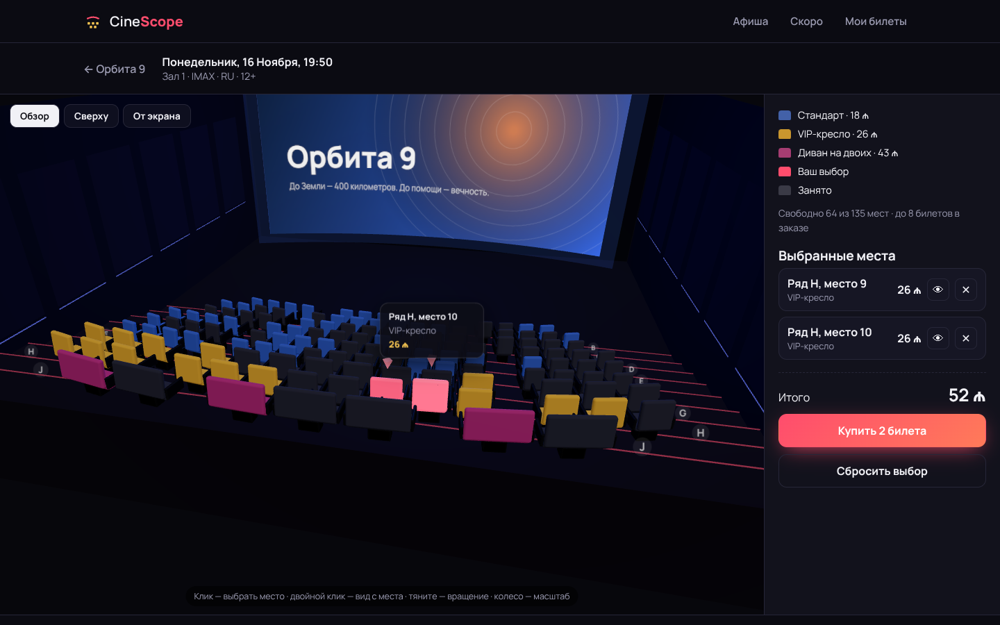
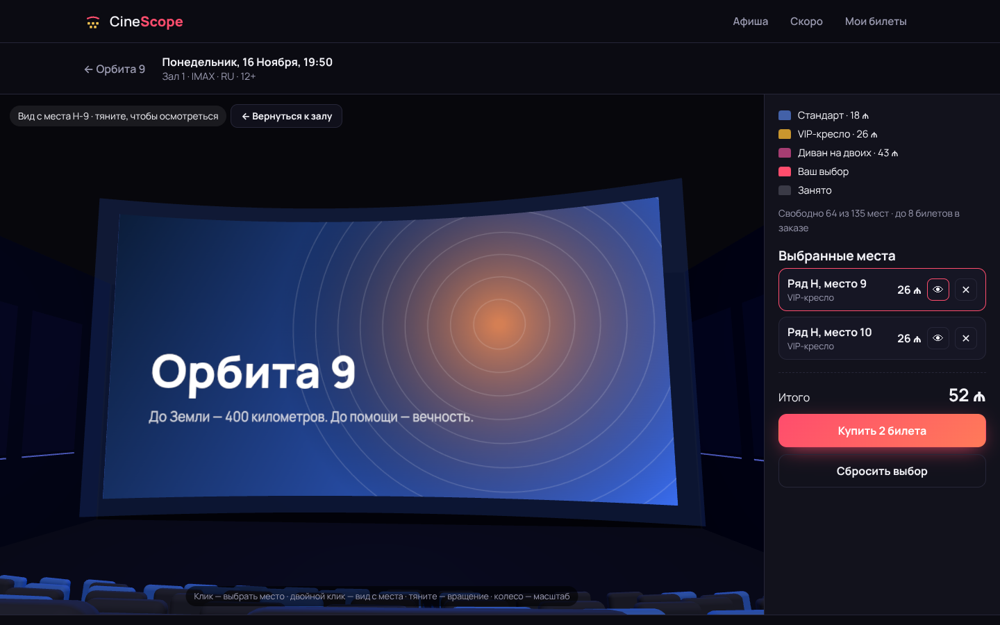
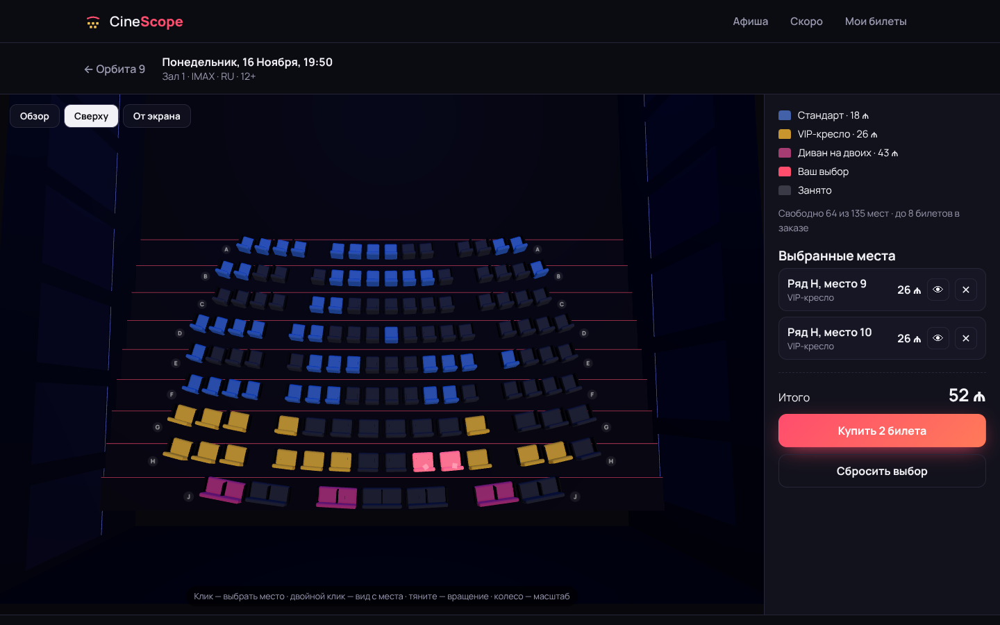
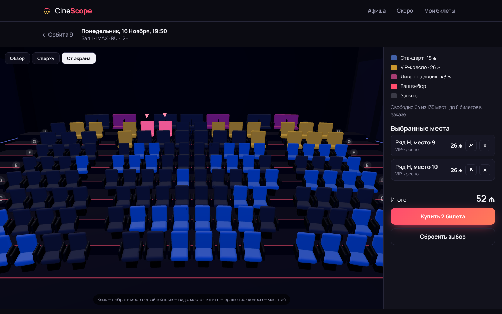
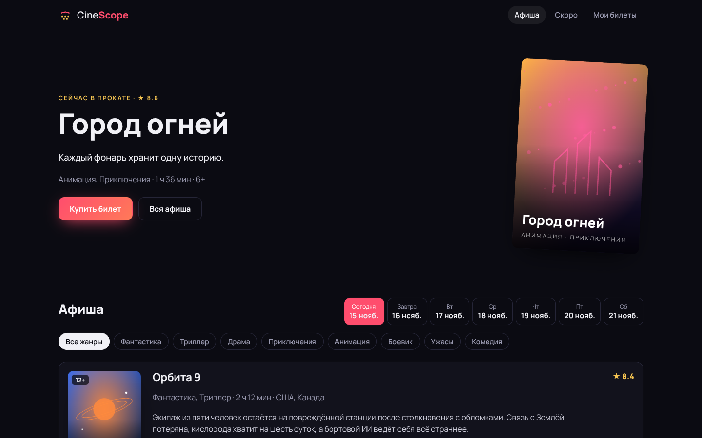
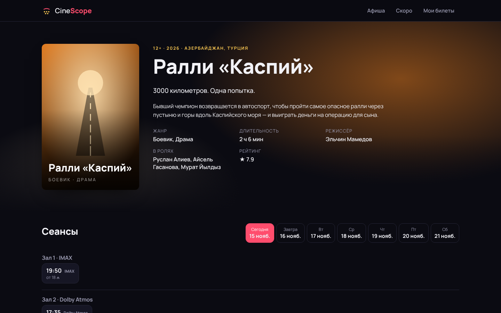
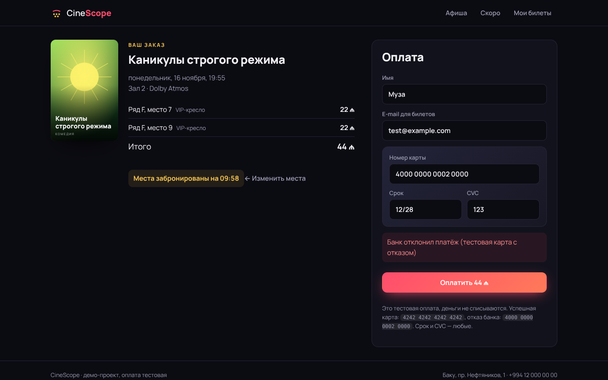
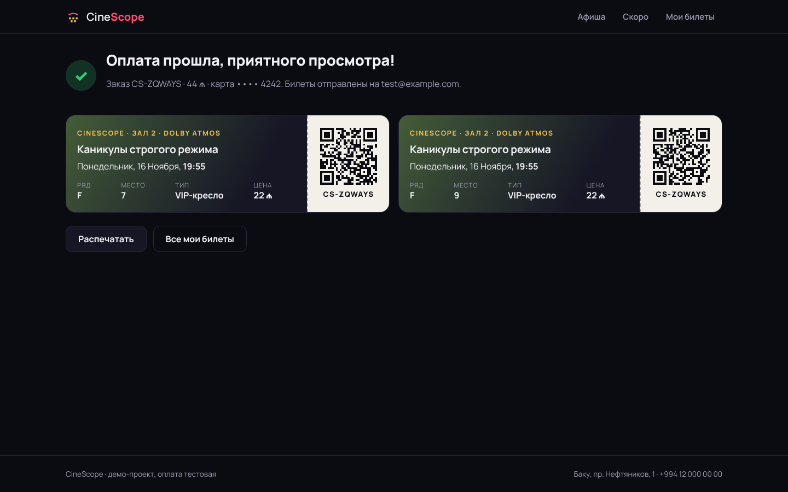
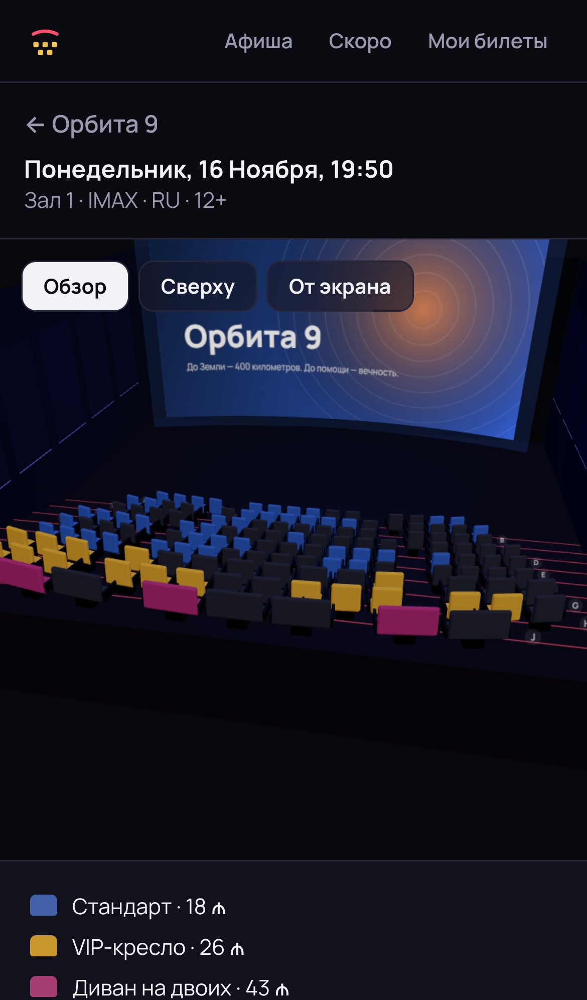

<div align="center">


# CineScope

**Сайт кинотеатра с интерактивной 3D-схемой зала**

Афиша, расписание сеансов, покупка билетов и выбор мест прямо в объёмной модели кинозала —
с возможностью заранее посмотреть, как будет виден экран с выбранного кресла.

[**Открыть демо**](https://cinescope-psi-seven.vercel.app)


<br />



</div>

---

## Возможности

### 3D-выбор мест

Главная часть проекта. Зал построен на Three.js и React Three Fiber и выглядит как настоящий кинотеатр:
ряды поднимаются амфитеатром, края рядов загнуты к экрану, а на изогнутом экране «идёт» выбранный фильм.

- Три типа мест с отдельными моделями и ценами: **стандарт**, **VIP-кресло**, **диван на двоих**.
- При наведении показываются ряд, место и цена; клик выбирает место, повторный клик снимает выбор.
- Ракурсы **«Обзор»**, **«Сверху»** и **«От экрана»** с плавным перелётом камеры.
- **Вид с места** — камера садится в выбранное кресло, можно осмотреться и оценить обзор экрана.
- Вращение, масштаб и тапы работают и на телефоне.

<table>
  <tr>
    <td width="50%"></td>
    <td width="50%"></td>
  </tr>
  <tr>
    <td align="center"><sub>Вид с выбранного места</sub></td>
    <td align="center"><sub>Схема зала сверху</sub></td>
  </tr>
  <tr>
    <td width="50%"></td>
    <td width="50%"></td>
  </tr>
  <tr>
    <td align="center"><sub>Вид от экрана</sub></td>
    <td align="center"><sub>Обзор зала и выбранные места</sub></td>
  </tr>
</table>

### Афиша и сеансы

- Фильмы в прокате с фильтром по дню (неделя вперёд) и жанру, сеансы прямо в карточке фильма.
- Страница фильма: описание, режиссёр, актёры, рейтинг и расписание по залам.
- Раздел «Скоро в кино» с датами премьер.
- Три зала разного формата: IMAX, Dolby Atmos и камерный, цены зависят от формата и времени сеанса.

<table>
  <tr>
    <td width="50%"></td>
    <td width="50%"></td>
  </tr>
  <tr>
    <td align="center"><sub>Главная и афиша</sub></td>
    <td align="center"><sub>Страница фильма и сеансы</sub></td>
  </tr>
</table>

### Покупка и билеты

- Места бронируются на 10 минут, таймер виден на странице оплаты.
- Форма оплаты с проверкой номера карты по алгоритму Луна и обработкой отказа банка.
- Электронные билеты с QR-кодом, печать, раздел «Мои билеты» и возврат.
- Купленные места сразу становятся занятыми на схеме зала.

<table>
  <tr>
    <td width="50%"></td>
    <td width="50%"></td>
  </tr>
  <tr>
    <td align="center"><sub>Оформление заказа</sub></td>
    <td align="center"><sub>Электронные билеты</sub></td>
  </tr>
</table>

### Мобильная версия



---

## Тестовая оплата

Оплата замокана, деньги не списываются.

| Номер карты | Результат |
|---|---|
| `4242 4242 4242 4242` | успешная оплата |
| `4000 0000 0002 0000` | отказ банка |

Срок действия и CVC — любые.

## Стек

| Слой | Технологии |
|---|---|
| Интерфейс | React 19, TypeScript, React Router, Vite |
| 3D | three.js, @react-three/fiber, @react-three/drei |
| Состояние | zustand (выбор мест), localStorage (заказы) |
| Прочее | qrcode.react |
| Хостинг | Vercel |

Постеры и изображение на экране зала генерируются из палитры фильма (SVG и canvas), поэтому проект
не зависит от сторонних картинок. Все фильмы в каталоге вымышленные.

## Архитектура

```
src/
├── api/          мок-API: фильмы, сеансы, занятые места, покупка, заказы
├── data/         каталог фильмов, раскладка залов, генератор расписания
├── three/        3D-сцена зала
│   ├── layout.ts         расчёт позиций рядов и кресел
│   ├── Seat.tsx          модель кресла и его состояния
│   ├── HallScene.tsx     сцена, свет, экран, камера и ракурсы
│   └── screenTexture.ts  изображение на экране
├── store/        zustand-стор выбранных мест
├── pages/        афиша, фильм, выбор мест, оплата, заказ, мои билеты
└── components/   постер, лента дат, билет, общий layout
```

- Интерфейс обращается к данным только через `src/api`. Функции асинхронные и возвращают те же структуры,
  что вернул бы сервер, поэтому мок можно заменить на настоящий бэкенд без правок в UI.
- 3D-сцена загружается отдельным чанком только при переходе к выбору мест, главная страница остаётся лёгкой.
- Геометрии и материалы кресел создаются один раз и переиспользуются всеми местами зала.

## Запуск

```bash
npm install
npm run dev       # http://localhost:5173
npm run build     # production-сборка в dist/
npm run preview   # просмотр собранной версии
```

Каждый пуш в `main` автоматически деплоится на Vercel.

## Планы

- [ ] Бэкенд (NestJS или FastAPI + PostgreSQL) для фильмов, залов, сеансов и заказов
- [ ] Блокировка мест на время оплаты (Redis TTL) и обновление схемы зала в реальном времени через WebSocket
- [ ] Подключение платёжного шлюза и отправка билетов на e-mail
- [ ] Аккаунты пользователей и админ-панель для расписания и цен
- [ ] Трейлеры, отзывы, бар и комбо-наборы при покупке
